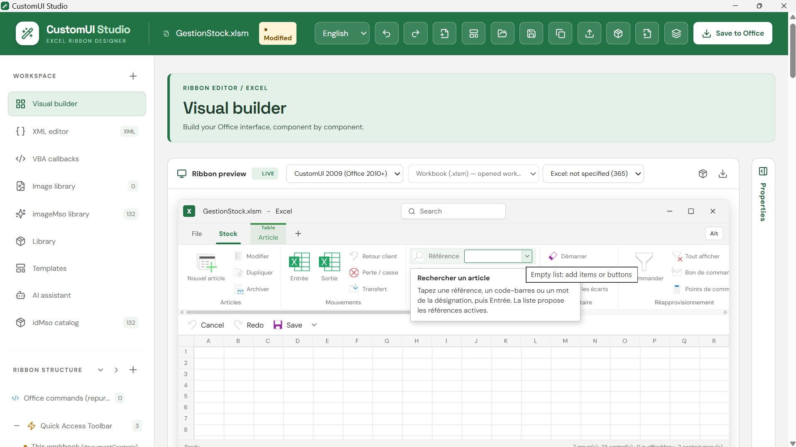
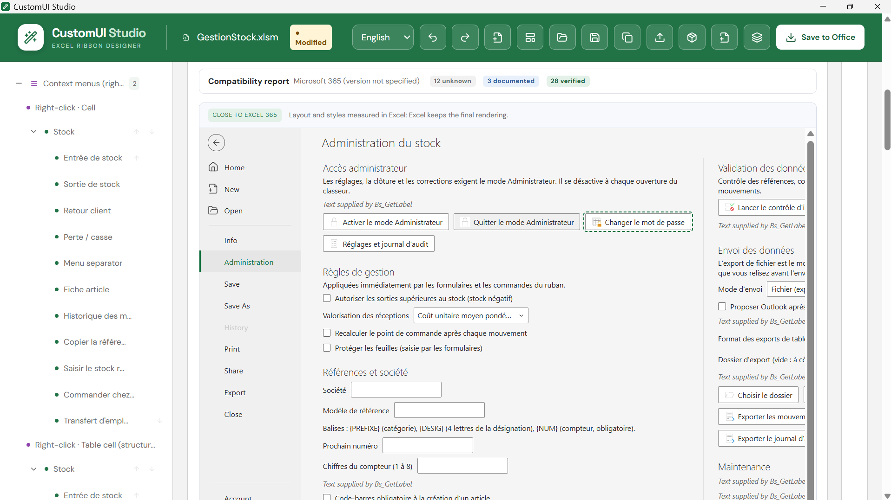
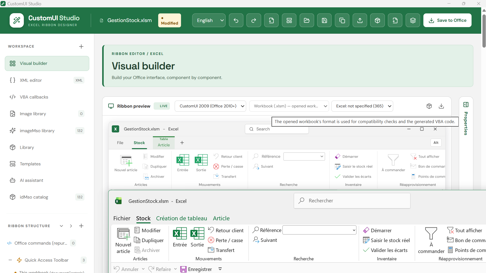
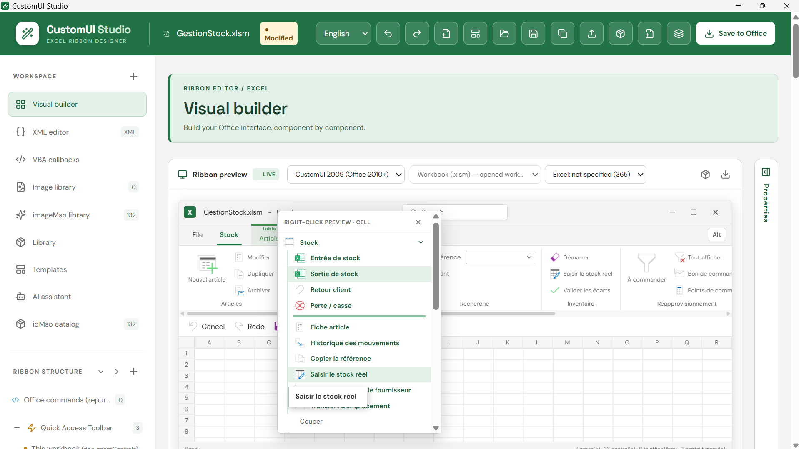
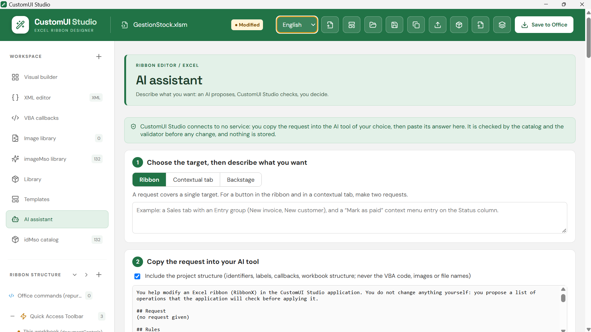
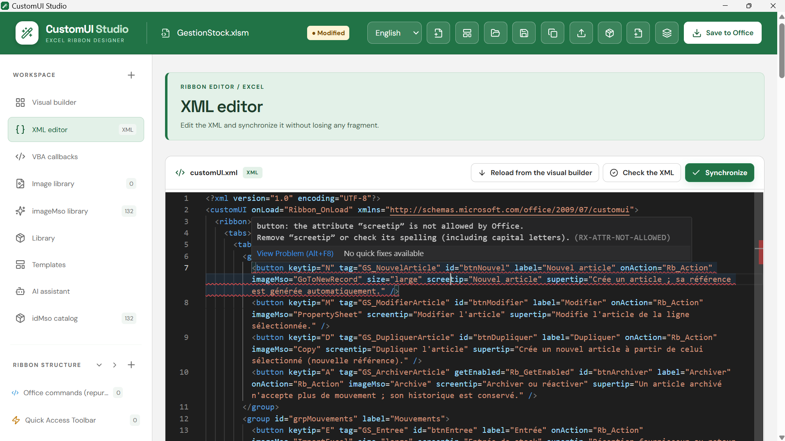

<p align="center">
  
</p>

<h1 align="center">CustomUI Studio</h1>

<p align="center">
  <a href="README.md">Français</a> · <b>English</b>
</p>

<p align="center">
  <b>Visual ribbon editor for Microsoft Excel — free, portable, no installation.</b><br>
  Build your tabs, groups, buttons and right-click menus with the mouse, without writing a single line of XML.
</p>

<p align="center">
  <a href="https://github.com/CustomUI-Studio/CustomUI-Studio/releases/latest"></a>
  <a href="https://github.com/CustomUI-Studio/CustomUI-Studio/releases"></a>
  
  
</p>

<p align="center">
  <a href="https://github.com/CustomUI-Studio/CustomUI-Studio/releases/latest/download/CustomUI.Studio.1.18.0.exe"><b>⬇️ Download CustomUI Studio 1.18.0</b></a>
  · <a href="https://apps.microsoft.com/detail/9PH54K3T7TCT"><b>Microsoft Store</b></a>
</p>



## Why CustomUI Studio?

Writing Excel ribbon XML by hand is tedious: one typo, one empty attribute or one duplicate identifier, and the ribbon does not show up, with no error message at all.

CustomUI Studio solves the problem at the source. You build the ribbon visually, the application only offers what Excel accepts, and it checks everything before writing to your workbook.

## In three steps

1. **Import** your `.xlsx` or `.xlsm` workbook or your `.xlam` add-in, or start from an empty ribbon or a template.
2. **Build** the ribbon: add tabs, groups and controls, pick their icons, set their properties. The preview updates live.
3. **Save**: the ribbon is written to the workbook, and the VBA module that goes with it is ready to import.

## Features

### Building the ribbon

- **All common controls**: buttons, toggle buttons, check boxes, edit boxes, drop-downs, combo boxes, galleries, menus, dynamic menus, split buttons.
- **Only allowed elements are offered**: you cannot build a ribbon that Excel would reject. The order required by the format is applied automatically.
- **Drag and drop**: rearrange tabs, groups and controls with the mouse in the Ribbon structure.
- **Duplicate, copy, paste** (Ctrl+D, Ctrl+C, Ctrl+V) a tab, a group or a control, even from one project to another: the copy gets its own identifiers and its own VBA procedures.
- **Live preview, just like in Excel**: lists, menus and tooltips can be tried out on hover.
- **Icons**: imageMso library sorted by category with search, your own images, and a catalog of Excel's built-in commands (Save, Copy, AutoSum…). With Excel installed, the preview shows Excel's real icons.
- **Two ribbon formats**: CustomUI 2006 (Office 2007) and CustomUI 2009 (Office 2010 and later).
- **Contextual tabs and Backstage**: extend the tabs Excel shows for a table, a chart or a picture, and build the File menu (Backstage) in the editor, with a preview close to Excel 365: Excel commands, hidden items, renamed items and the position of every added element. A File menu can also be stored in the library as a component; the "Backstage – Administration" component is included.

   
    See the XML code. 
   
  
- **Quick Access Toolbar**: add Excel commands, your own buttons and separators, shown when the workbook is active (or in all workbooks for an `.xlam` add-in). The application reminds you of what Excel requires (`startFromScratch`) and offers to keep Undo and Redo, which the workbook's toolbar replaces.
- **Excel tabs and groups**: add your groups to Home or another Excel tab, hide an Excel tab or group, copy any Excel group into your own tab (every group of every tab, drawn in the preview as in Excel), and place your tabs and groups before or after Excel's. Keyboard shortcuts (KeyTips) and display settings (disabled, image only, gallery columns…) in the inspector.
- **Workbook display**: hide the formula bar, the status bar, the ribbon, the sheet tabs, the headings or the gridlines, and give the window a title; the generated VBA code applies these settings and gives back to Excel whatever affects all workbooks when yours loses focus.
- **Undo / redo** (Ctrl+Z, Ctrl+Y) for every change.
- **Compatibility shown**: for the targeted Excel version, every command, icon and menu carries a "verified", "documented" or "unknown" badge, and a report summarizes the project.
- **In English or French**: the language is chosen at first launch and can be changed at any time.



### Projects, components and templates

- **`.cuis` projects**: save a ribbon independently of any workbook, reopen it, then apply it to the workbook of your choice.
- **Reusable `.cuic` components**: a group, a tab or a menu with its VBA code, ready to insert into any project. A local library keeps them organized, and several components are included (PDF export, sheet navigation…).
- **Ready-to-use templates**: inventory management, sales management, dashboard, each with its ribbon, its VBA code and the "Prepare the workbook" macro, which creates the expected sheets and tables without touching what already exists.

### Right-click menus

- **Your commands in Excel's right-click menus**: all 89 menus from Microsoft's official list (cell, row, column, table, sheet tab, charts, shapes, slicers…). You place them before or after an Excel command.
- **Entries shown only when they make sense**: on a given sheet, in a given table or column, on a non-empty cell… The VBA code for the conditions is generated for you.
- **Copy an entry to other menus** and organize entries into submenus.
- **Hide Excel commands in one click**: for the cell, row, column and table menus, tick the commands to keep or apply a preset ("Minimal menu", "No copy-paste"…).
- **Faithful preview**: the menu is displayed exactly as Excel will show it.
- Commands that the ribbon cannot hide are hidden through VBA, with the procedures generated for you.

Right-click menus require the CustomUI 2009 format.



### Generated VBA code

- **Ready-to-use `RibbonDESIGNER` module**: every callback has the correct signature, with examples in comments.
- **One-macro import**: `ImporterModuleRibbonDESIGNER` adds the module to your VBA project, without duplicates.
- **"Apply to a new workbook…" and the "Finish in Excel" guide**: the application creates the workbook, then shows the remaining steps (import the modules, paste a snippet, reopen). In the desktop version, the modules are saved next to the workbook and a button opens it in Excel.
- **Ribbon driven by your macros**: tick the properties of a control that should be able to change (label, disabled, hidden, image…), then a single line is enough:

  ```vb
  SetControlState "btnExporter", "enabled", False
  ```

### Add-ins and batch processing

- **`.xlam` Excel add-ins**: open, edit and save an add-in again; the generated VBA code adapts (it acts on the active workbook). A step-by-step procedure explains how to create the add-in in Excel.
- **Apply to several workbooks** (desktop version): pick workbooks or a folder, check them before writing, and get copies in an output folder along with a CSV report. The originals are never modified.

### Controlled AI assistant



- **Describe what you want**: the application prepares a request to paste into the AI tool of your choice, then checks its answer before making any change.
- **Three targets**: the ribbon and its right-click menus, a contextual tab (you pick the tab set: table, chart, picture…) or the File menu (Backstage), whose list the assistant shows as Excel will display it. A request covers a single target.
- **Nothing is made up**: an attribute, a control or a command the format does not know is rejected; every change is presented, deletions must be confirmed, and "Undo" reverts everything in one step.
- **No connection**: CustomUI Studio sends nothing. VBA code, images and file names are never included in the request.

### Checks before saving

- **Validation against Microsoft's schemas**, offline: the XML editor lists every problem with its line, a clear explanation and the fix to apply.
- **Saving is blocked while any error remains**: unknown or empty attribute, repeated identifier, misplaced control, wrong order…
- **"Problems" panel in the Visual builder**: errors are shown while you build; one click selects the element concerned.
- **XML editor kept in sync** with the interface.



## Your workbook is respected

When you click **Save to Office**, your workbook is not rebuilt:

- all its original parts are copied unchanged and checked before writing;
- only the ribbon changes: your sheets, your data and your VBA macros stay intact;
- an image you remove from the library is removed from the workbook along with its relationship;
- writing goes through a temporary file, which is read back and then swapped in. If anything goes wrong, the original file is left untouched.

## Installation

### Portable version

1. Download [`CustomUI.Studio.1.18.0.exe`](https://github.com/CustomUI-Studio/CustomUI-Studio/releases/latest/download/CustomUI.Studio.1.18.0.exe) from the [Releases](https://github.com/CustomUI-Studio/CustomUI-Studio/releases/latest) page.
2. Double-click it. No installation is needed.

> **"Windows protected your PC" message?**
> The portable executable is not digitally signed, which triggers the Windows SmartScreen warning on first launch. Click **More info**, then **Run anyway**.

<details>
<summary>Verify the downloaded file (optional)</summary>

<br>

SHA-256 hash of `CustomUI.Studio.1.18.0.exe`:

```
cecf15c36ef918ce0c3845e04f0ff0372f71bf7be7439e7fce813753e60cf1bc
```

To check it, in PowerShell:

```powershell
Get-FileHash .\CustomUI.Studio.1.18.0.exe -Algorithm SHA256
```

</details>

### Microsoft Store

CustomUI Studio is available on the [Microsoft Store](https://apps.microsoft.com/detail/9PH54K3T7TCT). The Store version is signed by Microsoft, installs without any Windows warning and updates automatically.

## Requirements

- Windows 64-bit
- Microsoft Excel for desktop, to use the workbooks produced
- Supported files: `.xlsx`, `.xlsm` and `.xlam` add-ins
- For the VBA module import macro: the Excel option **Trust access to the VBA project object model** must be enabled

## Good to know

- Changing the ribbon of a digitally signed workbook invalidates its signature: it must be signed again.
- A workbook downloaded from the Internet may be blocked by Windows (red banner). Right-click the file, choose **Properties**, tick **Unblock**.
- Validation covers the ribbon XML. Your macros and command identifiers are not checked: always test the ribbon in Excel.
- Drag and drop works in the Ribbon structure, not from the palette or in the preview.
- Right-click menus: some Excel commands can only be hidden through VBA ("VBA" label). This hiding affects all of Excel while the workbook is active; the procedures to paste into `ThisWorkbook` are provided at the top of the `RibbonDESIGNER` module.
- The list of Excel commands in right-click menus was surveyed in Excel for Microsoft 365, in French. Excel may show others depending on context and version.
- In English, the names of Excel commands in right-click menus and the generated VBA module remain in French.
- In an `.xlam` add-in, `ThisWorkbook` refers to the add-in itself: the generated code uses the active workbook, and the application flags component code that uses `ThisWorkbook`.
- The AI assistant handles neither library components nor custom images; in the File menu, it only sets the 13 Excel commands surveyed in Excel for Microsoft 365.

## Versions

The current version is 1.18.0. Details of each version are in the [version history](CHANGELOG.en.md).

## Questions, suggestions, bugs

Open a ticket in the [Issues](https://github.com/CustomUI-Studio/CustomUI-Studio/issues) tab of this repository.

## Privacy

CustomUI Studio collects and transmits no data, and works without an Internet connection, AI assistant included: you are the one who copies the request into your AI tool. See the [privacy policy](CONFIDENTIALITE.en.md).

## Third-party components

XML validation uses libxml2 (MIT license) through xmllint-wasm (MIT license). The CustomUI schemas are those of Microsoft Corporation.

## License

Free software (freeware), source code not published. See [LICENCE.en.txt](LICENCE.en.txt).

© 2026 Régis DEVAUX — All rights reserved.
