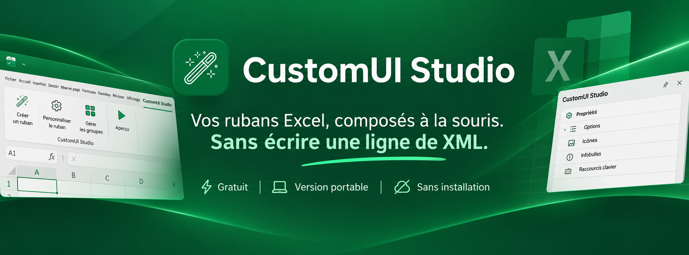
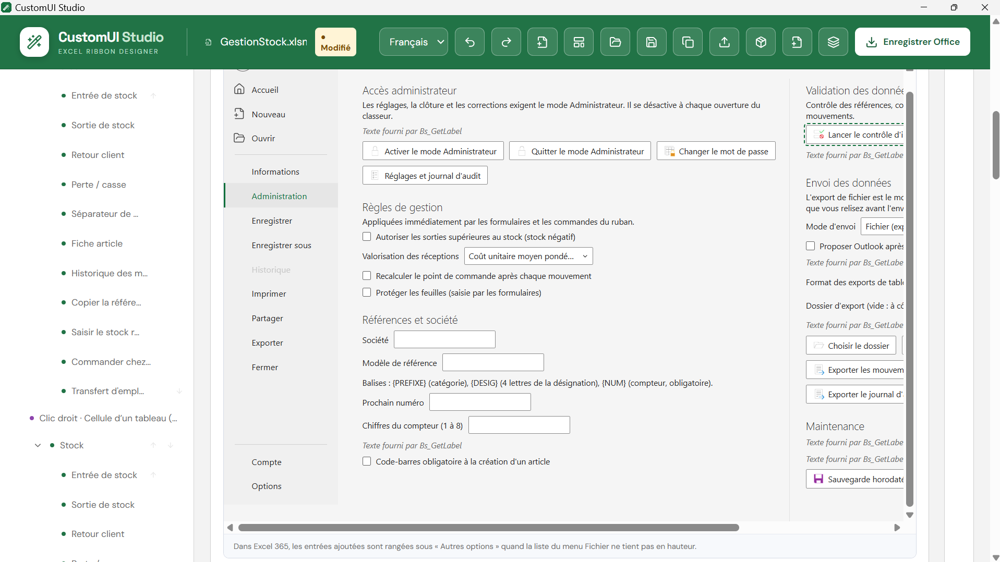

<p align="center">
  
</p>

<h1 align="center">CustomUI Studio</h1>

<p align="center">
  <a href="README.md">Français</a> · <b>English</b>
</p>

<p align="center">
  <b>Visual ribbon editor for Microsoft Excel — free, portable, no installation required.</b><br>
  Build your tabs, groups, buttons, and right-click menus with a mouse, without writing a single line of XML.
</p>

<p align="center">
  <a href="https://github.com/CustomUI-Studio/CustomUI-Studio/releases/latest"></a>
  <a href="https://github.com/CustomUI-Studio/CustomUI-Studio/releases"></a>
  
  
</p>

<p align="center">
  <a href="https://github.com/CustomUI-Studio/CustomUI-Studio/releases/latest/download/CustomUI.Studio.1.18.0.exe"><b>Download CustomUI Studio 1.18.0</b></a>
  · <a href="https://apps.microsoft.com/detail/9PH54K3T7TCT"><b>Microsoft Store</b></a>
</p>


## Why CustomUI Studio?

Writing Excel ribbon XML by hand is tedious: a single typo, an empty attribute, or a duplicate ID makes the entire ribbon disappear with no error message.

CustomUI Studio solves the problem at the source. You build the ribbon visually, the application only offers what Excel accepts, and it validates everything before writing to your workbook.

## In three steps

| 1. Import | 2. Build | 3. Save |
| :--- | :--- | :--- |
| Open your `.xlsx`, `.xlsm` workbook or `.xlam` add-in, or start from a blank ribbon or template. | Add tabs, groups, and controls, pick their icons, and adjust their properties. The preview updates live. | The ribbon is written into the workbook, and the matching VBA module is ready to import. |

## Features

### Build the ribbon

- **All standard controls**: buttons, toggle buttons, check boxes, edit boxes, drop-downs, combo boxes, galleries, menus, dynamic menus, and split buttons.
- **Only valid elements are offered**: it is impossible to build a ribbon that Excel would reject. The element order enforced by the schema is maintained automatically.
- **Drag and drop**: reorder tabs, groups, and controls with your mouse in the Ribbon Structure tree.
- **Duplicate, copy, paste** (Ctrl+D, Ctrl+C, Ctrl+V) any tab, group, or control, even across projects: the copy receives its own unique IDs and VBA procedures.
- **Live preview, just like Excel**: drop-downs, menus, and tooltips can be tested on hover.
- **Icons**: categorized `imageMso` library with search, your own custom images, and a catalog of built-in Excel commands (Save, Copy, AutoSum…). When Excel is installed, the preview renders authentic Excel icons.
- **Two ribbon formats**: CustomUI 2006 (Office 2007) and CustomUI 2009 (Office 2010 and later).
- **Contextual tabs and Backstage**: extend the tabs Excel displays for a table, chart, or picture, and design the File menu (Backstage) directly in the editor with a preview close to Excel 365: built-in Excel commands, visibility toggles, renames, and placement of every added item. A File menu can also be saved to the library as a reusable component; the "Backstage – Administration" component is included.

  
  [View generated XML code](docs/customUI.xml)

- **Quick Access Toolbar (QAT)**: add built-in Excel commands, your own buttons, and separators, displayed whenever the workbook is active (or across all workbooks for an `.xlam` add-in). The app reminds you of Excel's requirements (`startFromScratch`) and offers to keep Undo and Redo, which a custom workbook QAT otherwise replaces.
- **Built-in Excel tabs and groups**: add your own groups inside Home or any other built-in Excel tab, hide a built-in tab or group, copy any built-in Excel group into your custom tab (every group from every tab, rendered in the preview just like Excel), and position your tabs and groups before or after Excel's built-in ones. Keyboard shortcuts (keytips) and display settings (disabled, icon-only, gallery columns…) are available in the inspector.
- **Workbook display**: hide the formula bar, status bar, ribbon, sheet tabs, headings, or gridlines, and set a custom window title; the generated VBA code applies these settings and restores Excel's global UI elements whenever your workbook loses focus.
- **Undo / redo** (Ctrl+Z, Ctrl+Y) for every edit.
- **Displayed compatibility**: for the target Excel version, every command, icon, and menu carries a "verified", "documented", or "unknown" badge, and a summary report covers the whole project.
- **In English or French**: choose your language on first launch and switch at any time.


### Projects, components, and templates

- **Standalone `.cuis` projects**: save a ribbon independently of any workbook, reopen it later, and apply it to any workbook of your choice.
- **Reusable `.cuic` components**: a group, tab, or menu bundled with its VBA code, ready to insert into any project. A local library organizes them, and several components are included out of the box (PDF export, sheet navigation…).
- **Ready-to-use templates**: inventory management, sales management, and dashboard, complete with their ribbon, VBA code, and a "Prepare workbook" macro that creates the expected sheets and tables without touching existing data.

### Right-click context menus

- **Your commands in Excel's right-click menus**: all 89 menus from Microsoft's official list (cell, row, column, table, sheet tab, charts, shapes, slicers…). Place them before or after any built-in Excel command.
- **Context-aware entries**: show items only when they make sense—on a specific sheet, inside a specific table or column, on a non-empty cell… The conditional VBA code is generated for you.
- **Copy an entry across multiple menus** and organize items into submenus.
- **Hide built-in Excel commands in one click**: for cell, row, column, and table menus, check the commands to keep or apply a preset ("Minimal menu", "No copy-paste"…).
- **Accurate preview**: the menu displays just as Excel will render it.
- Commands that the ribbon XML cannot hide natively are hidden via VBA, with the required procedures generated automatically.

Right-click context menus require the CustomUI 2009 format.


### Generated VBA code

- **Ready-to-use `RibbonDESIGNER` module**: every callback has the exact signature, complete with commented usage examples.
- **One-macro import**: `ImporterModuleRibbonDESIGNER` inserts the module into your VBA project without duplicates.
- **"Apply to a new workbook…" and "Finish in Excel" guide**: the app creates the workbook and walks you through the remaining steps (importing modules, pasting a snippet, reopening). In the desktop version, modules are saved right next to the workbook and a button opens it directly in Excel.
- **Control the ribbon from your macros**: check which properties of a control should be dynamically adjustable (label, enabled, visible, image…), then a single line of VBA is all you need:

  ```vb
  SetControlState "btnExporter", "enabled", False
  ```

### Add-ins and batch processing

- **Excel `.xlam` add-ins**: open, edit, and resave an add-in; the generated VBA code adapts automatically to target `ActiveWorkbook`. A guided walkthrough explains how to create the add-in in Excel.
- **Apply to multiple workbooks** (desktop version): select individual workbooks or an entire folder, validate them before writing, and get updated copies in an output folder along with a CSV report. Original files are never modified.

### Controlled AI Assistant


- **Describe what you want**: the app prepares a structured prompt to paste into the AI tool of your choice, then validates its response before applying any changes.
- **Three targets**: the main ribbon and its right-click menus, a contextual tab set (table, chart, picture…), or the File menu (Backstage), for which the assistant lists items just as Excel displays them. Each request targets one area at a time.
- **Nothing is hallucinated**: any attribute, control, or command unknown to the schema is rejected; every change is previewed, deletions require confirmation, and "Undo" reverts everything in one step.
- **Zero network connection**: CustomUI Studio sends nothing online. Your VBA code, custom images, and file names are never included in the prompt.

### Pre-save validation

- **Offline validation against Microsoft schemas**: the XML editor lists every issue with its line number, a clear explanation, and how to fix it.
- **Saving blocked until all errors are resolved**: unknown or empty attributes, duplicate IDs, misplaced controls, invalid element order…
- **"Issues" panel in the Visual Builder**: errors appear live as you build; clicking an issue selects the corresponding element.
- **Synchronized XML editor** linked with the visual interface.


## Your workbook is respected

When you click **Save Office**, your workbook is never rebuilt from scratch:

- all original parts are copied verbatim and verified before writing;
- only the ribbon is updated: your sheets, data, and VBA macros remain untouched;
- any custom image removed from the library is cleanly stripped from the workbook along with its relationship;
- writing goes through a temporary file that is read back and verified before replacing the target. If anything goes wrong, the original file is left untouched.

## Installation

### Portable version

1. Download [`CustomUI.Studio.1.18.0.exe`](https://github.com/CustomUI-Studio/CustomUI-Studio/releases/latest/download/CustomUI.Studio.1.18.0.exe) from the [Releases](https://github.com/CustomUI-Studio/CustomUI-Studio/releases/latest) page.
2. Double-click the executable. No installation is required.

> [!NOTE]
> **"Windows protected your PC" message?**
> The portable executable is not digitally signed, which triggers a Windows SmartScreen warning on first launch. Click **More info** and then **Run anyway**.

<details>
<summary>Verify the downloaded file (optional)</summary>

<br>

SHA-256 checksum for `CustomUI.Studio.1.18.0.exe`:

```
cecf15c36ef918ce0c3845e04f0ff0372f71bf7be7439e7fce813753e60cf1bc
```

To verify it in PowerShell:

```powershell
Get-FileHash .\CustomUI.Studio.1.18.0.exe -Algorithm SHA256
```

</details>

### Microsoft Store

CustomUI Studio is available on the [Microsoft Store](https://apps.microsoft.com/detail/9PH54K3T7TCT). The Store version is signed by Microsoft, installs without any Windows warning, and updates automatically.

## System requirements

- 64-bit Windows
- Desktop Microsoft Excel, to use the generated workbooks
- Supported file formats: `.xlsx`, `.xlsm`, and `.xlam` add-ins
- For the VBA module import macro: Excel's **Trust access to the VBA project object model** option must be enabled

## Good to know

- Editing the ribbon of a digitally signed workbook invalidates its signature: you will need to re-sign it afterward.
- A workbook downloaded from the internet may be blocked by Windows (red security banner). Right-click the file, open **Properties**, and check **Unblock**.
- Validation checks the ribbon XML only. Your VBA macros and custom command IDs are not verified: always test your ribbon in Excel.
- Drag-and-drop reordering works inside the Ribbon Structure tree, not from the control palette or inside the live preview.
- Right-click menus: certain built-in Excel commands can only be hidden via VBA (marked with a "VBA" tag). This hiding applies across Excel while the workbook is active; the procedures to paste into `ThisWorkbook` are provided at the top of the `RibbonDESIGNER` module.
- The list of built-in Excel commands for right-click menus was cataloged in Excel for Microsoft 365 (French edition). Excel may display additional items depending on context and version.
- When the interface is switched to English, built-in right-click menu command names and the generated VBA module remain in French.
- In an `.xlam` add-in, `ThisWorkbook` refers to the add-in itself: generated code targets `ActiveWorkbook` instead, and the app warns you if a library component references `ThisWorkbook`.
- The AI Assistant does not manage library components or custom images; in the File menu (Backstage), it covers the 13 built-in Excel commands cataloged from Excel for Microsoft 365.

## Additional information

- **Releases**: the current version is 1.18.0. Full release notes are available in the [changelog](CHANGELOG.md).
- **Questions, suggestions, bugs**: open a ticket in the [Issues](https://github.com/CustomUI-Studio/CustomUI-Studio/issues) tab of this repository.
- **Privacy**: CustomUI Studio collects and transmits no data and works completely offline, including the AI Assistant (you copy and paste the prompt into your own AI tool). See the [privacy policy](CONFIDENTIALITE.md).
- **Third-party components**: XML validation uses libxml2 (MIT license) via xmllint-wasm (MIT license). CustomUI schemas are copyright Microsoft Corporation.
- **License**: freeware, closed source. See [LICENCE.txt](LICENCE.txt).

© 2026 Régis DEVAUX — All rights reserved.
