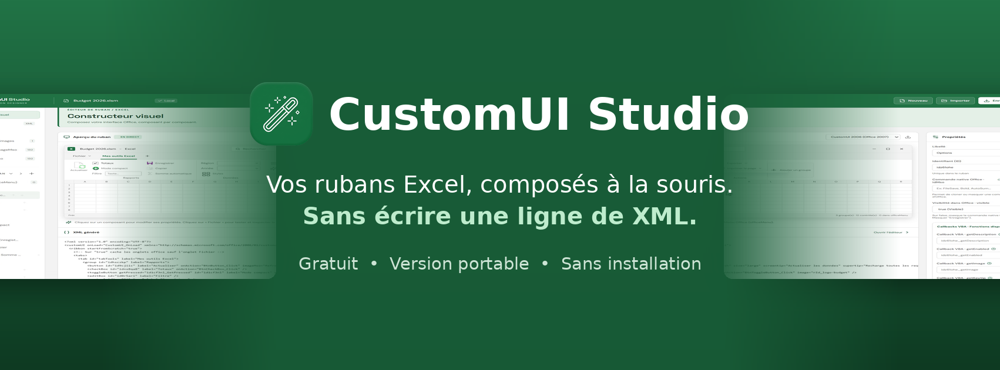
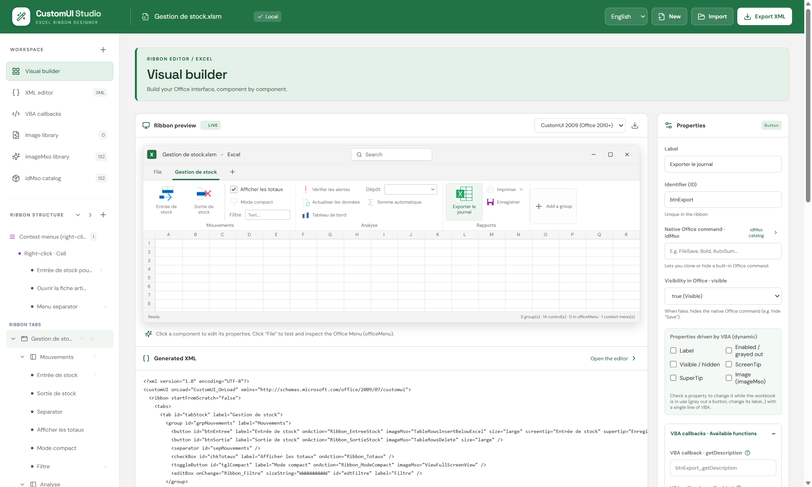

<p align="center">
  
</p>

<h1 align="center">CustomUI Studio</h1>

<p align="center">
  <a href="README.md">Français</a> · <b>English</b>
</p>

<p align="center">
  <b>Visual ribbon editor for Microsoft Excel — free, portable, no installation.</b><br>
  Build your tabs, groups, buttons and right-click menus with the mouse, without writing a line of XML.
</p>

<p align="center">
  <a href="https://github.com/CustomUI-Studio/CustomUI-Studio/releases/latest"></a>
  <a href="https://github.com/CustomUI-Studio/CustomUI-Studio/releases"></a>
  
  
</p>

<p align="center">
  <a href="https://github.com/CustomUI-Studio/CustomUI-Studio/releases/latest/download/CustomUI.Studio.1.0.0.exe"><b>⬇️ Download CustomUI Studio 1.0.0</b></a>
</p>



## Why CustomUI Studio?

Writing Excel ribbon XML by hand is tedious: one typo, one empty attribute or one duplicate identifier, and the ribbon does not show up, with no error message at all.

CustomUI Studio fixes the problem at the source. You build the ribbon visually, the application only offers what Excel accepts, and it checks everything before writing to your workbook.

## Three steps

1. **Import** your `.xlsx` or `.xlsm` workbook, or start from an empty ribbon.
2. **Build** the ribbon: add tabs, groups and controls, pick their icons, set their properties. The preview updates live.
3. **Save**: the ribbon is written into the workbook, and the matching VBA module is ready to import.

## Features

### Build the ribbon

- **All the usual controls**: buttons, toggle buttons, check boxes, edit boxes, drop-downs, combo boxes, galleries, menus, dynamic menus, split buttons.
- **Only allowed elements are offered**: you cannot build a ribbon that Excel would reject. The order required by the format is applied automatically.
- **Drag and drop**: reorder tabs, groups and controls with the mouse in the Ribbon structure.
- **Live preview, as in Excel**: lists, menus and tooltips can be tried on hover.
- **Icons**: imageMso library sorted by category with search, your own images, and a catalog of native Excel commands (Save, Copy, AutoSum…). With Excel installed, the preview shows the real Excel icons.
- **Two ribbon formats**: CustomUI 2006 (Office 2007) and CustomUI 2009 (Office 2010 and later).
- **In French or English**: the language is chosen at first launch and can be changed at any time.

### Right-click menus

- **Your commands in Excel's right-click menus**: cell, row or column header, table, PivotTable, shape. You place them before or after an Excel command.
- **Hide Excel commands in one click**: for the cell, row, column and table menus, tick the commands to keep or apply a preset ("Minimal menu", "No copy-paste"…).
- **Faithful preview**: the menu is shown as Excel will display it.
- Commands the ribbon cannot hide are hidden by VBA, with the procedures generated for you.

Right-click menus require the CustomUI 2009 format.

### Generated VBA code

- **Ready-to-use `RibbonDESIGNER` module**: every callback has the right signature, with examples in comments.
- **Import with one macro**: `ImporterModuleRibbonDESIGNER` adds the module to your VBA project, without duplicates.
- **Ribbon driven by your macros**: tick the properties of a control that must be able to change (label, grayed out, hidden, image…), then a single line is enough:

  ```vb
  SetControlState "btnExporter", "enabled", False
  ```

### Checks before saving

- **Validation against Microsoft's schemas**, offline: the XML editor lists each problem with its line, a clear explanation and the fix to apply.
- **Saving is blocked while an error remains**: unknown or empty attribute, duplicate identifier, misplaced control, wrong order…
- **XML editor kept in sync** with the interface. Parts that are not handled visually (Backstage, contextual tabs) are kept as they are.

## Your workbook is respected

When you click **Save to Office**, your workbook is not rebuilt:

- all its original parts are copied unchanged and checked before writing;
- only the ribbon changes: your sheets, your data and your VBA macros stay intact;
- an image you delete from the library is removed from the workbook along with its relationship;
- writing goes through a temporary file, read back and then swapped in. If anything goes wrong, the original file is not touched.

## Installation

### Portable version

1. Download [`CustomUI.Studio.1.0.0.exe`](https://github.com/CustomUI-Studio/CustomUI-Studio/releases/latest/download/CustomUI.Studio.1.0.0.exe) from the [Releases](https://github.com/CustomUI-Studio/CustomUI-Studio/releases/latest) page.
2. Double-click it. No installation is needed.

> **"Windows protected your PC" message?**
> The portable executable is not digitally signed, which triggers the Windows SmartScreen warning at first launch. Click **More info**, then **Run anyway**.

<details>
<summary>Verify the downloaded file (optional)</summary>

<br>

SHA-256 hash of `CustomUI.Studio.1.0.0.exe`:

```
bf1e050d78f5d59f764fc5e34be550746cb8a4711cd5d47ab9c8e45841e4a93f
```

To check it, in PowerShell:

```powershell
Get-FileHash .\CustomUI.Studio.1.0.0.exe -Algorithm SHA256
```

</details>

### Microsoft Store

An installable version, signed by Microsoft, is being published on the Microsoft Store. The link will be added here as soon as it is available.

## Requirements

- Windows 64-bit
- Microsoft Excel for desktop, to use the workbooks you produce
- Supported files: `.xlsx` and `.xlsm`
- For the macro that imports the VBA module: Excel option **Trust access to the VBA project object model** enabled

## Good to know

- In English, the names of Excel commands in right-click menus and the generated VBA module remain in French.
- Changing the ribbon of a digitally signed workbook invalidates its signature: it must be signed again.
- A workbook downloaded from the Internet may be blocked by Windows (red banner). Right-click the file, **Properties**, tick **Unblock**.
- Validation covers the ribbon XML. Your macros and command identifiers are not checked: always test the ribbon in Excel.
- Drag and drop works in the Ribbon structure, not from the palette or in the preview.
- Right-click menus: some Excel commands can only be hidden by VBA ("VBA" tag). This hiding applies to all of Excel while the workbook is active; the procedures to paste into `ThisWorkbook` are provided at the top of the `RibbonDESIGNER` module.
- The list of Excel commands in right-click menus was recorded in Excel for Microsoft 365, in French. Excel may show others depending on context and version.

## Versions

Version 1.0.0 is the first stable release. Details of each version are in the [version history](CHANGELOG.md) (in French).

## Questions, suggestions, bugs

Open a ticket in the [Issues](https://github.com/CustomUI-Studio/CustomUI-Studio/issues) tab of this repository.

## Privacy

CustomUI Studio does not collect or transmit any data, and works without an Internet connection. See the [privacy policy](CONFIDENTIALITE.md).

## Third-party components

XML validation uses libxml2 (MIT license) through xmllint-wasm (MIT license). The CustomUI schemas are those of Microsoft Corporation.

## License

Free software (freeware), source code not published. See [LICENCE.txt](LICENCE.txt) (in French).

© 2026 Régis DEVAUX — All rights reserved.
