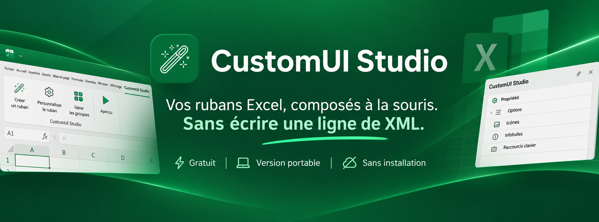
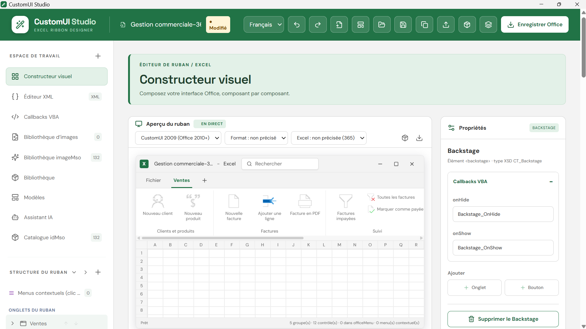
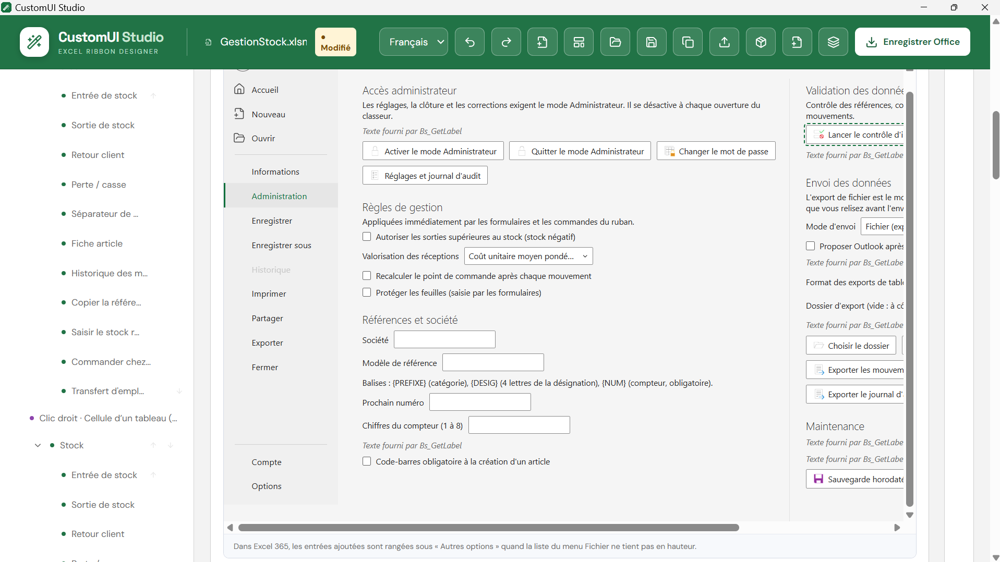
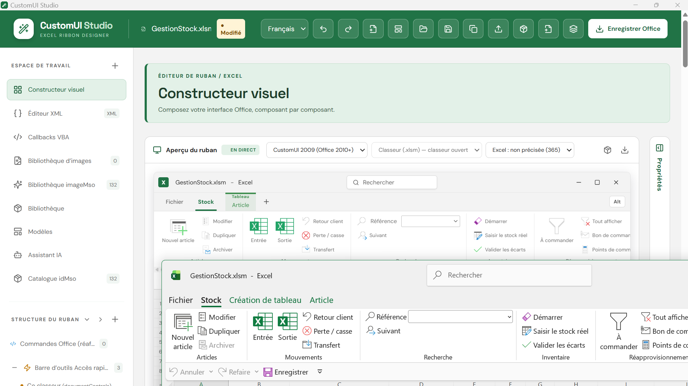
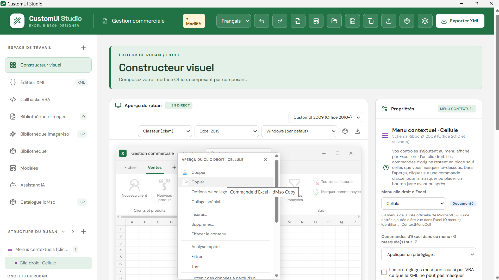
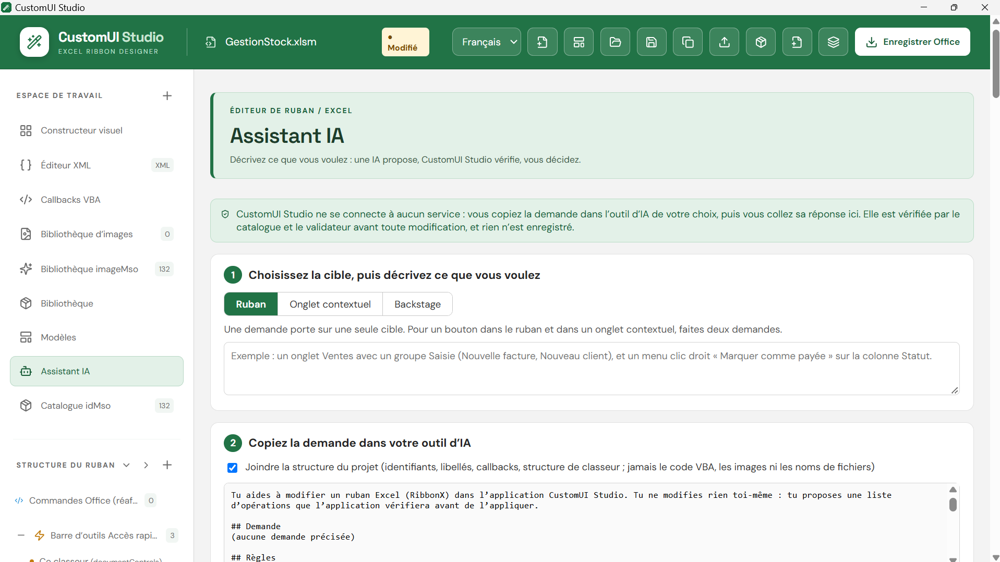
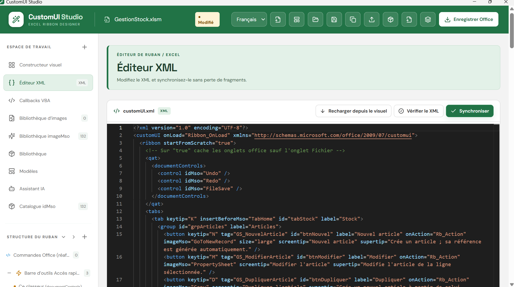

<p align="center">
  
</p>

<h1 align="center">CustomUI Studio</h1>

<p align="center">
  <b>Français</b> · <a href="README.en.md">English</a>
</p>

<p align="center">
  <b>Éditeur visuel de rubans pour Microsoft Excel — gratuit, portable, sans installation.</b><br>
  Composez vos onglets, groupes, boutons et menus clic droit à la souris, sans écrire une ligne de XML.
</p>

<p align="center">
  <a href="https://github.com/CustomUI-Studio/CustomUI-Studio/releases/latest"></a>
  <a href="https://github.com/CustomUI-Studio/CustomUI-Studio/releases"></a>
  
  
</p>

<p align="center">
  <a href="https://github.com/CustomUI-Studio/CustomUI-Studio/releases/latest/download/CustomUI.Studio.1.18.0.exe"><b>⬇️ Télécharger CustomUI Studio 1.18.0</b></a>
  · <a href="https://apps.microsoft.com/detail/9PH54K3T7TCT"><b>Microsoft Store</b></a>
</p>



## Pourquoi CustomUI Studio ?

Écrire le XML d'un ruban Excel à la main est fastidieux : une faute de frappe, un attribut vide ou un identifiant en double, et le ruban ne s'affiche pas, sans aucun message d'erreur.

CustomUI Studio règle le problème à la source. Vous construisez le ruban visuellement, l'application ne vous propose que ce qu'Excel accepte, et elle contrôle tout avant d'écrire dans votre classeur.

## En trois étapes

1. **Importez** votre classeur `.xlsx`, `.xlsm` ou votre complément `.xlam`, ou partez d'un ruban vide ou d'un modèle.
2. **Composez** le ruban : ajoutez onglets, groupes et contrôles, choisissez leurs icônes, réglez leurs propriétés. L'aperçu se met à jour en direct.
3. **Enregistrez** : le ruban est écrit dans le classeur, et le module VBA qui l'accompagne est prêt à importer.

## Fonctionnalités

### Construire le ruban

- **Tous les contrôles courants** : boutons, boutons bascule, cases à cocher, zones de saisie, listes déroulantes, combo box, galeries, menus, menus dynamiques, boutons fractionnés.
- **Seuls les éléments autorisés sont proposés** : impossible de construire un ruban qu'Excel refuserait. L'ordre imposé par le format est respecté automatiquement.
- **Glisser-déposer** : réorganisez onglets, groupes et contrôles à la souris dans la Structure du ruban.
- **Dupliquer, copier, coller** (Ctrl+D, Ctrl+C, Ctrl+V) un onglet, un groupe ou un contrôle, aussi d'un projet à l'autre : la copie reçoit ses propres identifiants et ses propres procédures VBA.
- **Aperçu en direct, comme dans Excel** : listes, menus et info-bulles se testent au survol.
- **Icônes** : bibliothèque imageMso classée par catégorie avec recherche, vos propres images, et catalogue des commandes natives d'Excel (Enregistrer, Copier, Somme automatique…). Avec Excel installé, l'aperçu affiche les vraies icônes d'Excel.
- **Deux formats de ruban** : CustomUI 2006 (Office 2007) et CustomUI 2009 (Office 2010 et versions suivantes).
- **Onglets contextuels et Backstage** : complétez les onglets qu'Excel affiche pour un tableau, un graphique ou une image, et construisez le menu Fichier (Backstage) dans l'éditeur, avec un aperçu proche d'Excel 365 : commandes d'Excel, masquages, renommages et place de chaque élément ajouté. Un menu Fichier se range aussi dans la bibliothèque comme composant ; le composant « Backstage – Administration » est fourni.
  
   
    Voir le code du ruban XML.
   
  
- **Barre d'outils Accès rapide** : ajoutez des commandes d'Excel, vos propres boutons et des séparateurs, affichés quand le classeur est actif (ou dans tous les classeurs pour un complément `.xlam`). L'application rappelle ce qu'Excel exige (`startFromScratch`) et propose de garder Annuler et Refaire, que la barre du classeur remplace.
- **Onglets et groupes d'Excel** : ajoutez vos groupes dans Accueil ou un autre onglet d'Excel, masquez un onglet ou un groupe d'Excel, copiez dans votre onglet n'importe quel groupe d'Excel (tous les groupes de chaque onglet, dessinés dans l'aperçu comme dans Excel), et placez vos onglets et groupes avant ou après ceux d'Excel. Raccourcis clavier et réglages d'affichage (grisé, image seule, colonnes de galerie…) dans l'inspecteur.
- **Affichage du classeur** : masquez la barre de formule, la barre d'état, le ruban, les onglets de feuilles, les en-têtes ou le quadrillage, et donnez un titre à la fenêtre ; le code VBA généré applique ces réglages et rend à Excel ce qui agit sur tous les classeurs quand le vôtre perd la main.
- **Annuler / rétablir** (Ctrl+Z, Ctrl+Y) pour chaque modification.
- **Compatibilité affichée** : pour la version d'Excel visée, chaque commande, icône et menu porte un badge « vérifié », « documenté » ou « inconnu », et un rapport résume le projet.
- **En français ou en anglais** : la langue se choisit au premier lancement et se change à tout moment.


### Projets, composants et modèles

- **Projets `.cuis`** : enregistrez un ruban indépendamment de tout classeur, rouvrez-le, puis appliquez-le au classeur de votre choix.
- **Composants réutilisables `.cuic`** : un groupe, un onglet ou un menu avec son code VBA, à insérer dans n'importe quel projet. Une bibliothèque locale les range, et plusieurs composants sont fournis (export PDF, navigation entre feuilles…).
- **Modèles prêts à l'emploi** : gestion de stocks, gestion commerciale, tableau de bord, avec leur ruban, leur code VBA et la macro « Préparer le classeur », qui crée les feuilles et les tableaux attendus sans toucher à l'existant.

### Menus clic droit

- **Vos commandes dans le clic droit d'Excel** : les 89 menus de la liste officielle de Microsoft (cellule, ligne, colonne, tableau, onglet de feuille, graphiques, formes, segments…). Vous les placez avant ou après une commande d'Excel.
- **Entrées affichées seulement quand elles ont un sens** : sur telle feuille, dans tel tableau ou telle colonne, sur une cellule non vide… Le code VBA des conditions est généré pour vous.
- **Copier une entrée vers d'autres menus** et la ranger dans des sous-menus.
- **Masquer les commandes d'Excel en un clic** : pour la cellule, la ligne, la colonne et le tableau, cochez les commandes à garder ou appliquez un préréglage (« Menu minimal », « Sans copier-coller »…).
- **Aperçu fidèle** : le menu s'affiche tel qu'Excel le montrera.
- Les commandes que le ruban ne peut pas masquer le sont par VBA, avec les procédures générées pour vous.

Les menus clic droit demandent le format CustomUI 2009.



### Code VBA généré

- **Module `RibbonDESIGNER` prêt à l'emploi** : chaque callback a la bonne signature, avec des exemples en commentaire.
- **Import en une macro** : `ImporterModuleRibbonDESIGNER` place le module dans votre projet VBA, sans doublon.
- **« Appliquer à un nouveau classeur… » et guide « Terminer dans Excel »** : l'application crée le classeur, puis montre les étapes qui restent (importer les modules, coller un extrait, rouvrir). Dans la version de bureau, les modules s'enregistrent à côté du classeur et un bouton l'ouvre dans Excel.
- **Ruban piloté par vos macros** : cochez les propriétés d'un contrôle qui doivent pouvoir changer (libellé, grisé, masqué, image…), puis une seule ligne suffit :

  ```vb
  SetControlState "btnExporter", "enabled", False
  ```

### Compléments et traitement par lot

- **Compléments Excel `.xlam`** : ouvrez, modifiez et réenregistrez un complément ; le code VBA généré s'adapte (il agit sur le classeur actif). Une procédure guidée explique comment créer le complément dans Excel.
- **Appliquer à plusieurs classeurs** (version de bureau) : choisissez des classeurs ou un dossier, contrôlez-les avant d'écrire, et obtenez des copies dans un dossier de sortie et un rapport CSV. Les originaux ne sont jamais modifiés.

### Assistant IA contrôlé



- **Décrivez ce que vous voulez** : l'application prépare une demande à coller dans l'outil d'IA de votre choix, puis vérifie sa réponse avant toute modification.
- **Trois cibles** : le ruban et ses menus clic droit, un onglet contextuel (vous choisissez le jeu : tableau, graphique, image…) ou le menu Fichier (Backstage), dont l'assistant affiche la liste telle qu'Excel la montrera. Une demande porte sur une seule cible.
- **Rien n'est inventé** : un attribut, un contrôle ou une commande que le format ne connaît pas est refusé ; chaque changement est présenté, les suppressions sont confirmées, et « Annuler » revient en arrière en une étape.
- **Aucune connexion** : CustomUI Studio n'envoie rien. Le code VBA, les images et les noms de fichiers ne figurent jamais dans la demande.

### Contrôle avant l'enregistrement

- **Vérification avec les schémas de Microsoft**, hors ligne : l'éditeur XML liste chaque problème avec sa ligne, une explication claire et la correction à faire.
- **Enregistrement bloqué tant qu'il reste une erreur** : attribut inconnu ou vide, identifiant répété, contrôle mal placé, ordre incorrect…
- **Panneau « Problèmes » dans le Constructeur visuel** : les erreurs s'affichent pendant la construction ; un clic sélectionne l'élément concerné.
- **Éditeur XML synchronisé** avec l'interface.



## Votre classeur est respecté

Quand vous cliquez sur **Enregistrer Office**, votre classeur n'est pas reconstruit :

- toutes ses parties d'origine sont recopiées à l'identique et vérifiées avant l'écriture ;
- seul le ruban change : vos feuilles, vos données et vos macros VBA restent intactes ;
- une image que vous supprimez de la bibliothèque est retirée du classeur avec sa liaison ;
- l'écriture passe par un fichier temporaire, relu puis substitué. En cas de problème, le fichier d'origine n'est pas touché.

## Installation

### Version portable

1. Téléchargez [`CustomUI.Studio.1.18.0.exe`](https://github.com/CustomUI-Studio/CustomUI-Studio/releases/latest/download/CustomUI.Studio.1.18.0.exe) depuis la page [Releases](https://github.com/CustomUI-Studio/CustomUI-Studio/releases/latest).
2. Double-cliquez dessus. Aucune installation n'est nécessaire.

> **Message « Windows a protégé votre ordinateur » ?**
> L'exécutable portable n'est pas signé numériquement, ce qui déclenche l'avertissement Windows SmartScreen au premier lancement. Cliquez sur **Informations complémentaires** puis **Exécuter quand même**.

<details>
<summary>Vérifier le fichier téléchargé (facultatif)</summary>

<br>

Empreinte SHA-256 de `CustomUI.Studio.1.18.0.exe` :

```
cecf15c36ef918ce0c3845e04f0ff0372f71bf7be7439e7fce813753e60cf1bc
```

Pour la vérifier, dans PowerShell :

```powershell
Get-FileHash .\CustomUI.Studio.1.18.0.exe -Algorithm SHA256
```

</details>

### Microsoft Store

CustomUI Studio est disponible sur le [Microsoft Store](https://apps.microsoft.com/detail/9PH54K3T7TCT). La version du Store est signée par Microsoft, s'installe sans avertissement Windows et se met à jour automatiquement.

## Configuration requise

- Windows 64 bits
- Microsoft Excel de bureau, pour utiliser les classeurs produits
- Fichiers pris en charge : `.xlsx`, `.xlsm` et compléments `.xlam`
- Pour la macro d'import du module VBA : option Excel **Accès approuvé au modèle d'objet du projet VBA** activée

## Bon à savoir

- Modifier le ruban d'un classeur signé numériquement invalide sa signature : il faut le signer à nouveau.
- Un classeur téléchargé sur Internet peut être bloqué par Windows (bannière rouge). Clic droit sur le fichier, **Propriétés**, cochez **Débloquer**.
- La vérification porte sur le XML du ruban. Vos macros et les identifiants de commandes ne sont pas contrôlés : testez toujours le ruban dans Excel.
- Le glisser-déposer se fait dans la Structure du ruban, pas depuis la palette ni dans l'aperçu.
- Menus clic droit : certaines commandes d'Excel ne se masquent que par VBA (étiquette « VBA »). Ce masquage agit sur tout Excel tant que le classeur est actif ; les procédures à coller dans `ThisWorkbook` sont fournies en tête du module `RibbonDESIGNER`.
- La liste des commandes d'Excel des menus clic droit a été relevée dans Excel pour Microsoft 365, en français. Excel peut en afficher d'autres selon le contexte et la version.
- En anglais, les noms des commandes d'Excel des menus clic droit et le module VBA généré restent en français.
- Dans un complément `.xlam`, `ThisWorkbook` désigne le complément lui-même : le code généré utilise le classeur actif, et l'application signale le code des composants qui utilise `ThisWorkbook`.
- L'assistant IA ne gère ni les composants de la bibliothèque ni les images personnalisées ; dans le menu Fichier, il ne règle que les 13 commandes d'Excel relevées dans Excel pour Microsoft 365.

## Versions

La version actuelle est la 1.18.0. Le détail de chaque version est dans l'[historique des versions](CHANGELOG.md).

## Questions, suggestions, bugs

Ouvrez un ticket dans l'onglet [Issues](https://github.com/CustomUI-Studio/CustomUI-Studio/issues) de ce dépôt.

## Confidentialité

CustomUI Studio ne collecte et ne transmet aucune donnée, et fonctionne sans connexion à Internet, assistant IA compris : c'est vous qui copiez la demande dans votre outil d'IA. Voir la [politique de confidentialité](CONFIDENTIALITE.md).

## Composants tiers

La vérification du XML utilise libxml2 (licence MIT) par l'intermédiaire de xmllint-wasm (licence MIT). Les schémas CustomUI sont ceux de Microsoft Corporation.

## Licence

Logiciel gratuit (freeware), code source non publié. Voir [LICENCE.txt](LICENCE.txt).

© 2026 Régis DEVAUX — Tous droits réservés.
