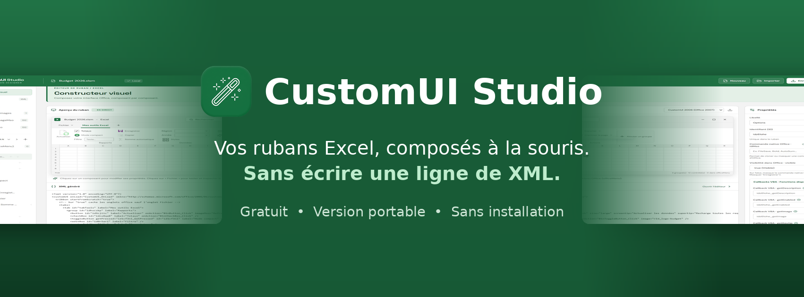
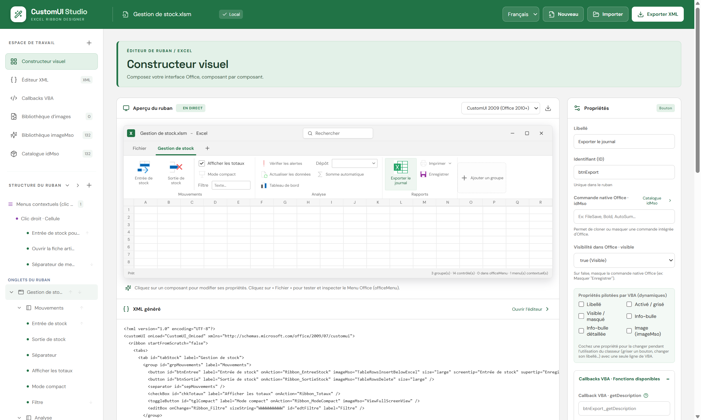
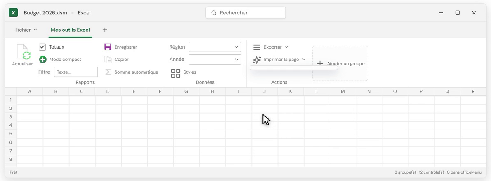

<p align="center">
  
</p>

<h1 align="center">CustomUI Studio</h1>

<p align="center">
  <b>Éditeur de rubans pour Microsoft Excel — gratuit, portable, sans installation.</b><br>
  Composez vos onglets, groupes et boutons à la souris, sans écrire une ligne de XML.
</p>

<p align="center">
  <a href="../../releases/latest"><b>⬇️ Télécharger la dernière version</b></a>
</p>

---

## Pourquoi CustomUI Studio ?

Écrire le XML d'un ruban Excel à la main, c'est fastidieux : une faute de frappe, un attribut vide ou un identifiant en double, et le ruban ne s'affiche pas, sans aucun message d'erreur.

CustomUI Studio règle le problème à la source : vous construisez le ruban visuellement, l'application ne vous propose que ce qu'Excel accepte, et elle contrôle tout avant d'écrire dans votre classeur.



## Fonctionnalités

- **Construction visuelle** : onglets, groupes, boutons, boutons bascule, cases à cocher, zones de saisie, listes déroulantes, combo box, galeries, menus, menus dynamiques, boutons fractionnés.
- **Seuls les éléments autorisés sont proposés** : impossible de construire un ruban qu'Excel refuserait. L'ordre imposé par le format est respecté automatiquement.
- **Deux formats de ruban** : CustomUI 2006 (Office 2007) et CustomUI 2009 (Office 2010 et versions suivantes).
- **Aperçu en direct, comme dans Excel** : listes, menus et info-bulles testables au survol.
- **Icônes** : bibliothèque imageMso classée par catégorie avec recherche, vos propres images, et catalogue des commandes natives d'Excel (Enregistrer, Copier, Somme automatique…).
- **Code VBA prêt à l'emploi** : le module `RibbonDESIGNER` est généré avec la bonne signature pour chaque callback. Une seule macro, `ImporterModuleRibbonDESIGNER`, l'importe dans votre projet VBA, sans doublon.
- **Éditeur XML** synchronisé avec l'interface. Les parties non gérées visuellement (menus contextuels, commentaires) sont conservées telles quelles.
- **Contrôle avant chaque enregistrement** : attribut vide, identifiant répété, contrôle mal placé ou ordre incorrect sont signalés.



## Votre classeur est respecté

Quand vous cliquez sur **Enregistrer Office**, votre classeur n'est pas reconstruit :

- toutes ses parties d'origine sont recopiées à l'identique et vérifiées avant l'écriture ;
- seul le ruban change : vos feuilles, vos données et vos macros VBA restent intactes ;
- l'écriture passe par un fichier temporaire, relu puis substitué. En cas de problème, le fichier d'origine n'est pas touché.

## Installation

1. Téléchargez `CustomUI-Studio-1.0.0-portable.exe` depuis la page [Releases](../../releases/latest).
2. Double-cliquez dessus. Aucune installation n'est nécessaire.

> **Message « Windows a protégé votre ordinateur » ?**
> L'exécutable n'est pas signé numériquement, ce qui déclenche l'avertissement Windows SmartScreen au premier lancement. Cliquez sur **Informations complémentaires** puis **Exécuter quand même**.

### Vérifier le fichier téléchargé (facultatif)

Empreinte SHA-256 de `CustomUI-Studio-1.0.0-portable.exe` :

```
2efeb2ed4e5b175a7dac014b767a3f0421baaec8a804065243bf1b1750601c37
```

Pour la vérifier, dans PowerShell :

```powershell
Get-FileHash .\CustomUI-Studio-0.3.0-portable.exe -Algorithm SHA256
```

## Configuration requise

- Windows 64 bits
- Microsoft Excel de bureau, pour utiliser les classeurs produits
- Fichiers pris en charge : `.xlsx` et `.xlsm`
- Pour la macro d'import du module VBA : option Excel **Accès approuvé au modèle d'objet du projet VBA** activée

## Bon à savoir

- Modifier le ruban d'un classeur signé numériquement invalide sa signature : il faut le signer à nouveau.
- Un classeur téléchargé sur Internet peut être bloqué par Windows (bannière rouge). Clic droit sur le fichier, **Propriétés**, cochez **Débloquer**.

## Questions, suggestions, bugs

Ouvrez un ticket dans l'onglet [Issues](../../issues) de ce dépôt.

## Licence

Logiciel gratuit (freeware), code source non publié. Voir [LICENCE.txt](LICENCE.txt).

© 2026 Régis DEVAUX — Tous droits réservés.
