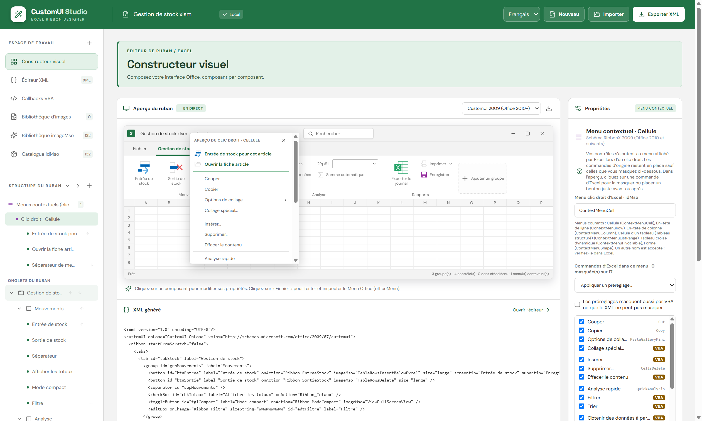
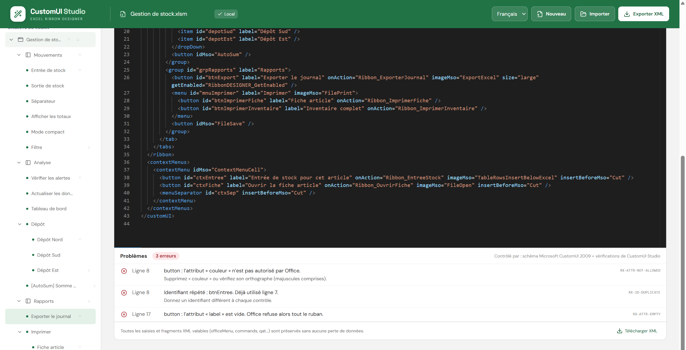

<p align="center">
  
</p>

<h1 align="center">CustomUI Studio</h1>

<p align="center">
  <b>Français</b> · <a href="README.en.md">English</a>
</p>

<p align="center">
  <b>Éditeur visuel de rubans pour Microsoft Excel — gratuit, portable, sans installation.</b><br>
  Composez vos onglets, groupes, boutons et menus clic droit à la souris, sans écrire une ligne de XML.
</p>

<p align="center">
  <a href="https://github.com/CustomUI-Studio/CustomUI-Studio/releases/latest"></a>
  <a href="https://github.com/CustomUI-Studio/CustomUI-Studio/releases"></a>
  
  
</p>

<p align="center">
  <a href="https://github.com/CustomUI-Studio/CustomUI-Studio/releases/latest/download/CustomUI.Studio.1.0.0.exe"><b>⬇️ Télécharger CustomUI Studio 1.0.0</b></a>
</p>


## Pourquoi CustomUI Studio ?

Écrire le XML d'un ruban Excel à la main est fastidieux : une faute de frappe, un attribut vide ou un identifiant en double, et le ruban ne s'affiche pas, sans aucun message d'erreur.

CustomUI Studio règle le problème à la source. Vous construisez le ruban visuellement, l'application ne vous propose que ce qu'Excel accepte, et elle contrôle tout avant d'écrire dans votre classeur.

## En trois étapes

1. **Importez** votre classeur `.xlsx` ou `.xlsm`, ou partez d'un ruban vide.
2. **Composez** le ruban : ajoutez onglets, groupes et contrôles, choisissez leurs icônes, réglez leurs propriétés. L'aperçu se met à jour en direct.
3. **Enregistrez** : le ruban est écrit dans le classeur, et le module VBA qui l'accompagne est prêt à importer.

## Fonctionnalités

### Construire le ruban

- **Tous les contrôles courants** : boutons, boutons bascule, cases à cocher, zones de saisie, listes déroulantes, combo box, galeries, menus, menus dynamiques, boutons fractionnés.
- **Seuls les éléments autorisés sont proposés** : impossible de construire un ruban qu'Excel refuserait. L'ordre imposé par le format est respecté automatiquement.
- **Glisser-déposer** : réorganisez onglets, groupes et contrôles à la souris dans la Structure du ruban.
- **Aperçu en direct, comme dans Excel** : listes, menus et info-bulles se testent au survol.
- **Icônes** : bibliothèque imageMso classée par catégorie avec recherche, vos propres images, et catalogue des commandes natives d'Excel (Enregistrer, Copier, Somme automatique…). Avec Excel installé, l'aperçu affiche les vraies icônes d'Excel.
- **Deux formats de ruban** : CustomUI 2006 (Office 2007) et CustomUI 2009 (Office 2010 et versions suivantes).
- **En français ou en anglais** : la langue se choisit au premier lancement et se change à tout moment.


### Menus clic droit

- **Vos commandes dans le clic droit d'Excel** : cellule, en-tête de ligne ou de colonne, tableau, tableau croisé dynamique, forme. Vous les placez avant ou après une commande d'Excel.
- **Masquer les commandes d'Excel en un clic** : pour la cellule, la ligne, la colonne et le tableau, cochez les commandes à garder ou appliquez un préréglage (« Menu minimal », « Sans copier-coller »…).
- **Aperçu fidèle** : le menu s'affiche tel qu'Excel le montrera.
- Les commandes que le ruban ne peut pas masquer le sont par VBA, avec les procédures générées pour vous.

Les menus clic droit demandent le format CustomUI 2009.



### Code VBA généré

- **Module `RibbonDESIGNER` prêt à l'emploi** : chaque callback a la bonne signature, avec des exemples en commentaire.
- **Import en une macro** : `ImporterModuleRibbonDESIGNER` place le module dans votre projet VBA, sans doublon.
- **Ruban piloté par vos macros** : cochez les propriétés d'un contrôle qui doivent pouvoir changer (libellé, grisé, masqué, image…), puis une seule ligne suffit :

  ```vb
  SetControlState "btnExporter", "enabled", False
  ```

### Contrôle avant l'enregistrement

- **Vérification avec les schémas de Microsoft**, hors ligne : l'éditeur XML liste chaque problème avec sa ligne, une explication claire et la correction à faire.
- **Enregistrement bloqué tant qu'il reste une erreur** : attribut inconnu ou vide, identifiant répété, contrôle mal placé, ordre incorrect…
- **Éditeur XML synchronisé** avec l'interface. Les parties non gérées visuellement (Backstage, onglets contextuels) sont conservées telles quelles.



## Votre classeur est respecté

Quand vous cliquez sur **Enregistrer Office**, votre classeur n'est pas reconstruit :

- toutes ses parties d'origine sont recopiées à l'identique et vérifiées avant l'écriture ;
- seul le ruban change : vos feuilles, vos données et vos macros VBA restent intactes ;
- une image que vous supprimez de la bibliothèque est retirée du classeur avec sa liaison ;
- l'écriture passe par un fichier temporaire, relu puis substitué. En cas de problème, le fichier d'origine n'est pas touché.

## Installation

### Version portable

1. Téléchargez [`CustomUI.Studio.1.0.0.exe`](https://github.com/CustomUI-Studio/CustomUI-Studio/releases/latest/download/CustomUI.Studio.1.0.0.exe) depuis la page [Releases](https://github.com/CustomUI-Studio/CustomUI-Studio/releases/latest).
2. Double-cliquez dessus. Aucune installation n'est nécessaire.

> **Message « Windows a protégé votre ordinateur » ?**
> L'exécutable portable n'est pas signé numériquement, ce qui déclenche l'avertissement Windows SmartScreen au premier lancement. Cliquez sur **Informations complémentaires** puis **Exécuter quand même**.

<details>
<summary>Vérifier le fichier téléchargé (facultatif)</summary>

<br>

Empreinte SHA-256 de `CustomUI.Studio.1.0.0.exe` :

```
bf1e050d78f5d59f764fc5e34be550746cb8a4711cd5d47ab9c8e45841e4a93f
```

Pour la vérifier, dans PowerShell :

```powershell
Get-FileHash .\CustomUI.Studio.1.0.0.exe -Algorithm SHA256
```

</details>

### Microsoft Store

Une version installable, signée par Microsoft, est en cours de publication sur le Microsoft Store. Le lien sera ajouté ici dès qu'elle sera disponible.

## Configuration requise

- Windows 64 bits
- Microsoft Excel de bureau, pour utiliser les classeurs produits
- Fichiers pris en charge : `.xlsx` et `.xlsm`
- Pour la macro d'import du module VBA : option Excel **Accès approuvé au modèle d'objet du projet VBA** activée

## Bon à savoir

- Modifier le ruban d'un classeur signé numériquement invalide sa signature : il faut le signer à nouveau.
- Un classeur téléchargé sur Internet peut être bloqué par Windows (bannière rouge). Clic droit sur le fichier, **Propriétés**, cochez **Débloquer**.
- La vérification porte sur le XML du ruban. Vos macros et les identifiants de commandes ne sont pas contrôlés : testez toujours le ruban dans Excel.
- Le glisser-déposer se fait dans la Structure du ruban, pas depuis la palette ni dans l'aperçu.
- Menus clic droit : certaines commandes d'Excel ne se masquent que par VBA (étiquette « VBA »). Ce masquage agit sur tout Excel tant que le classeur est actif ; les procédures à coller dans `ThisWorkbook` sont fournies en tête du module `RibbonDESIGNER`.
- La liste des commandes d'Excel des menus clic droit a été relevée dans Excel pour Microsoft 365, en français. Excel peut en afficher d'autres selon le contexte et la version.
- En anglais, les noms des commandes d'Excel des menus clic droit et le module VBA généré restent en français.

## Versions

La version 1.0.0 est la première version stable. Le détail de chaque version est dans l'[historique des versions](CHANGELOG.md).

## Questions, suggestions, bugs

Ouvrez un ticket dans l'onglet [Issues](https://github.com/CustomUI-Studio/CustomUI-Studio/issues) de ce dépôt.

## Confidentialité

CustomUI Studio ne collecte et ne transmet aucune donnée, et fonctionne sans connexion à Internet. Voir la [politique de confidentialité](CONFIDENTIALITE.md).

## Composants tiers

La vérification du XML utilise libxml2 (licence MIT) par l'intermédiaire de xmllint-wasm (licence MIT). Les schémas CustomUI sont ceux de Microsoft Corporation.

## Licence

Logiciel gratuit (freeware), code source non publié. Voir [LICENCE.txt](LICENCE.txt).

© 2026 Régis DEVAUX — Tous droits réservés.
